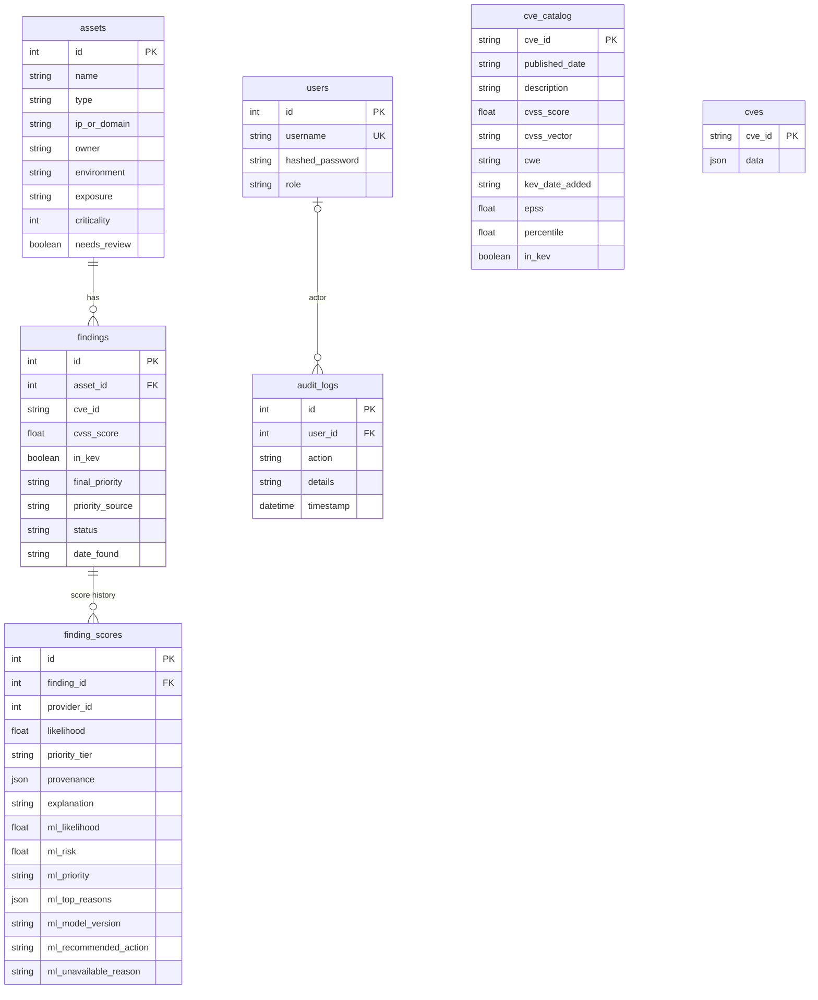
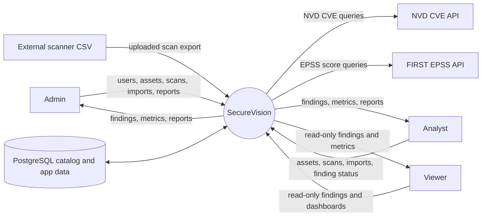
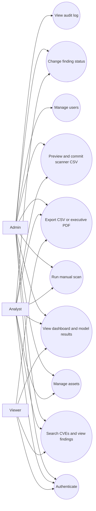

# SecureVision Architecture and Flows

This reference reflects the checked-in implementation. Where proposal or older
documentation terminology differs from the code, the implementation is called
out explicitly below.

## System architecture and priority flow

```mermaid
flowchart TD
    Operator[Admin or Analyst] --> UI[Next.js SecureVision UI]
    UI -->|Manual scan POST /scan| API[FastAPI backend]
    UI -->|Scanner CSV preview / commit| Import[CSV validation and import]
    Import --> API
    API --> Auth[JWT authentication and role checks]
    API --> Catalog[(PostgreSQL cve_catalog<br/>384,522 rows in the recorded load<br/>cve_id primary-key index)]
    API --> Cache[(PostgreSQL cves cache)]
    API -->|Catalog/cache miss| Providers[NVD CVE API and FIRST EPSS API]
    Providers -->|provider result or explicit unavailable error| API
    Catalog -->|offline CVE metadata| API
    API --> Intel[CVSS, EPSS, KEV label and description]
    Intel --> Rules[calculate_priority<br/>deterministic tier / 320-case matrix cross-check]
    Intel --> Warmup{ML warm-up state}
    Warmup -->|startup thread; bundle-load lock| Bundle[Verify frozen_config and model SHA-256<br/>load 152-feature XGBoost + train-fitted TF-IDF]
    Bundle --> ML[Probability and asset risk<br/>SHAP; native XGBoost contributions fallback]
    Rules --> Select{PRIORITY_MODE}
    ML --> Select
    Select -->|deterministic default| RuleResult[Final priority = rule tier]
    Select -->|ml_asset and ML available| MLResult[Final priority = ML asset tier]
    MLResult --> KevFloor{in_kev and below High?}
    KevFloor -->|yes| Floor[Apply CISA KEV High floor]
    KevFloor -->|no| Persist
    Floor --> Persist[(Persist finding, finding_scores history and audit event)]
    RuleResult --> Persist
    Persist --> Detail[GET /findings/{id}]
    Detail --> Drawer[Finding details drawer<br/>final priority, rule cross-check, ML likelihood/risk,<br/>top reasons, model version, recommended action]
```

### Runtime boundaries

- The API starts a daemon warm-up thread in the FastAPI lifespan. Model loading is
  serialized by `_BUNDLE_LOAD_LOCK`; warm-up state reads/writes use
  `_WARMUP_STATE_LOCK`. A failed warm-up leaves an explicit unavailable reason.
- `backend/ml_inference.py` checks the frozen model hash, feature count/order,
  TF-IDF vocabulary and excludes feature names containing KEV or EPSS. It builds
  a 152-value feature row and obtains explanation contributions from SHAP, with
  native XGBoost contributions as the fallback.
- The default in `backend/rules_config.py` is `deterministic`. ML inference is
  advisory in this mode. `ml_asset` selects the ML asset-risk tier when the
  prediction is available; if the finding is in KEV, the result cannot be lower
  than High. An unavailable ML prediction falls back to the deterministic tier.
- The deterministic implementation is the branch logic in
  `backend/scoring_engine.py`. `docs/scoring_matrix_v1.csv` and its tests cover
  the 320 input combinations; runtime scoring is not a table lookup.
- The recorded manual catalog load inserted 384,522 CSV records
  (`Decision_Log.md`). The count is loader/deployment data, not a row-count
  constraint in Alembic. `cve_catalog.cve_id` is the primary key and therefore
  indexed.
- CVE lookup uses the local catalog/cache and then live NVD/FIRST EPSS providers.
  `backend/threat_intel.py` does not call a live KEV endpoint. KEV data is
  available in the prepared catalog or as scan input; it must not be described
  as a live-provider fallback.

## Entity-relationship diagram

The diagram shows the current PostgreSQL schema from SQLAlchemy models and
Alembic revisions. The proposal's name `priority_scores` is not a physical
table: score history is stored in `finding_scores`. The legacy `cves` cache is
also part of the current schema.



### Constraints, indexes and database roles

| Area | Implemented behavior |
|---|---|
| Asset names | `uq_assets_name_ci` is a unique expression index on `lower(assets.name)`. A separate ordinary `ix_assets_name` index is also declared by the ORM. |
| Finding identity | `uq_findings_asset_cve` is a unique constraint on `(asset_id, cve_id)`; API CVE identifiers are normalized to uppercase. It is not a case-insensitive database index. |
| Usernames | `ix_users_username` is a unique B-tree index. User-creation code checks case-folded names, but the database index itself is not a `lower(username)` expression index. |
| Other ORM indexes | `ix_assets_id`, `ix_findings_id`, `ix_findings_asset_id`, `ix_findings_cve_id`, `ix_findings_final_priority`, and `ix_finding_scores_id` are declared by the models/migrations. `users.id` and `audit_logs.id` also have `ix_users_id` and `ix_audit_logs_id`. |
| Catalog | `cve_catalog.cve_id` is the primary key / lookup index. The app role receives SELECT only. |
| Runtime app role | Revision `0003` removes public/schema DDL access and grants table DML and sequence USAGE; `0004` excludes UPDATE/DELETE/TRUNCATE and other mutation privileges on `audit_logs`; `0005` grants the runtime role SELECT only on `cve_catalog`. The runtime role cannot perform schema DDL. |
| Audit immutability | PostgreSQL triggers reject audit-row UPDATE and DELETE (`0001`) and TRUNCATE (`0002`). SQLAlchemy model hooks also reject ORM update/delete. Audit entries are written by application actions and remain append-only. |

## Data-flow diagrams

### Level 0: context



### Level 1: scan, persistence and display

```mermaid
flowchart TD
    A[Manual scan form or CSV upload] --> B{Input path}
    B -->|Manual| C[Validate asset and CVE identifier]
    B -->|CSV| D[Detect format, validate rows, report duplicates/errors]
    D -->|Preview| A
    D -->|Commit valid rows| C
    C --> E[Lookup catalog; on miss use cache/provider path]
    E --> F[Fetch/enrich NVD and EPSS data<br/>report unavailable providers explicitly]
    F --> G[Calculate deterministic rule tier]
    F --> H[Attempt frozen 152-feature ML advisory]
    H --> I[Resolve final tier by priority mode<br/>and apply KEV floor in ml_asset]
    G --> I
    I --> J[(findings)]
    I --> K[(finding_scores)]
    I --> L[(audit_logs)]
    J --> M[GET /findings and GET /findings/{id}]
    K --> M
    L --> M
    M --> N[Findings table and detail drawer]
    N --> O[Final priority, source, rule tier, explanation,<br/>ML likelihood/risk/reasons/action or unavailable reason]
```

## Use-case diagram



All application endpoints except `POST /token` require a bearer token. Admin-only
and analyst/admin restrictions are enforced in route dependencies or handlers;
the Viewer is denied scan, import, asset mutation, finding status mutation and
audit-log access.

## Repository module reference

| Module / path | Responsibility and current state |
|---|---|
| `backend/main.py` | FastAPI lifespan/warm-up, login, asset/CVE/intelligence endpoints, model results, scans, findings, analytics, audit and CSV import routes. |
| `backend/auth.py` | JWT token issue/verification, PBKDF2 password hashing and login-attempt rate limiting. |
| `backend/users.py` | Admin-only user CRUD/role and password updates; appends audit events. |
| `backend/models.py` | SQLAlchemy models for `users`, `assets`, `cves`, `cve_catalog`, `findings`, `finding_scores`, and `audit_logs`; asset/findings relationships and ORM audit immutability hooks. |
| `backend/database.py` | PostgreSQL-only runtime SQLAlchemy engine and session dependency; SQLite accepted only under isolated test mode. |
| `backend/schemas.py` | Pydantic request/response shapes, field validation and role/mode literals. |
| `backend/scoring_engine.py` | Rule-based CVE/asset tier, score explanation and final-priority selection with optional ML/KEV floor. |
| `backend/rules_config.py` | Runtime priority mode, band thresholds, defaults, model/config/catalog paths and risk-action constants. |
| `backend/ml_inference.py` | Lock-protected frozen model load and validation, 152-feature assembly, likelihood/risk, SHAP/native contributions and warm-up state. |
| `backend/threat_intel.py` | FIRST EPSS and NVD HTTP lookups, response validation, errors and three explicit demonstration cache fixtures. No live KEV request. |
| `backend/cve_dataset.py` | Indexed `cve_catalog` lookup and bounded CVE/description search. |
| `backend/csv_import.py` | CSV format/header parsing, row validation, duplicates, size/row caps and safe problem CSV output. |
| `backend/model_results.py` | Read-only assembly of historic log results and the dated offline validation comparison for `/model/results`. |
| `backend/reports.py` | Authenticated filtered findings CSV and executive PDF exports; export metadata is audited. |
| `backend/demo_seed.py` | Explicit synthetic demo data seeding; not a production inventory feed. |
| `backend/init_db.py`, root `init_db.py` | Administrator bootstrap/runtime initialization; Alembic owns schema creation. |
| `backend/check_db.py` | Database connectivity/schema diagnostics. |
| `backend/generate_matrix.py`, `docs/scoring_matrix_v1.csv` | Generate the 320-combination rule cross-check; runtime tier logic remains in `scoring_engine.py`. |
| `backend/test_scoring.py` | Scoring test entry point for the documented matrix. |
| `alembic/versions/0001_initial_postgresql_schema.py` | Initial schema and audit UPDATE/DELETE trigger. |
| `alembic/versions/0002_prevent_audit_log_truncate.py` | Audit TRUNCATE trigger. |
| `alembic/versions/0003_postgres_uniqueness_and_app_privileges.py` | Duplicate checks, asset case-insensitive unique index, finding uniqueness and app-role grants. |
| `alembic/versions/0004_final_priority.py` | Adds and backfills finding final-priority and source fields; hardens grants. |
| `alembic/versions/0005_cve_catalog.py` | Creates the reference catalog with app-role SELECT-only permissions. |
| `scripts/load_cve_catalog.py` | Owner-only explicit streaming/upsert loader; not run automatically during startup. |
| `ml/features_splits.py` | Historical dated raw-data preprocessing and chronological train/validation/test CSV generation; its 2,000-token encoder is not the frozen production feature transformer. |
| `ml/run_pipeline.py` | Historical frozen 152-feature XGBoost evaluation pipeline and validation reference; also contains the prior test evaluation. Do not rerun its test path for this comparison. |
| `ml/run_pipeline_final.py`, `ml/g2_g9_pipeline.py`, `ml/run_p4_true.py` | Earlier pipeline/ablation experiments; not equivalent to the frozen 152-feature comparison protocol. |
| `ml/run_val2025_comparison.py` | Dated offline five-way Validation 2025 runner; uses the frozen 152-feature list, trains text/encoders on training only, and does not open the test split. |
| Other offline ML scripts | `ml/ablation_p4_strict.py`, `ml/audit_p2.py`, `ml/audit_p2_final.py`, `ml/audit_p2_strict.py`, `ml/check_epss.py`, `ml/check_regex.py`, `ml/check_regex_full.py`, `ml/download_data.py`, `ml/download_epss_history.py`, `ml/fetch_nvd.py`, `ml/final_p4_report.py`, `ml/inspect_tfidf.py`, `ml/merge_data.py`, `ml/p2_g1_audit.py`, `ml/p4_final_ablation.py`, `ml/p5_epss_subgroups.py`, `ml/preflight.py`, `ml/run_p2_true.py`, `ml/train_fixed.py`, `ml/train_models.py`, `ml/tune_models.py`, `ml/tune_models_refined.py`, `ml/ultimate_audit.py`. Historical download, audit, diagnostic, training and ablation entry points; not imported by the backend or the dated comparison runner. Review each script before manual execution because some historical pipelines write artifacts. |
| `ml/models/` | Frozen headline model and transformer plus separately named offline LR/RF comparison artifacts; `headline_*` artifacts are not changed by the comparison. |
| `frontend/src/app/SecureApp.tsx` | Authenticated application shell, navigation, shared view state and finding drawer mounting. |
| `frontend/src/api/client.ts`, `frontend/src/api/modelResults.ts` | Shared backend API client and model-results request wrapper. |
| `frontend/src/types/index.ts` | Shared frontend API/result types, including validation metrics and top-K maps. |
| `frontend/src/components/findings/FindingsView.tsx` | Findings list/filter/sort and detail selection. |
| `frontend/src/components/findings/FindingDetailsDrawer.tsx` | Final-priority explanation, rule cross-check and ML advisory detail. |
| `frontend/src/components/scan/ScanView.tsx`, `frontend/src/components/import/ImportView.tsx` | Manual scan and scanner CSV preview/commit UI. |
| `frontend/src/components/dashboard/DashboardView.tsx`, `frontend/src/components/dashboard/ModelResultsView.tsx` | Dashboard and model results tables/charts. |
| `frontend/src/components/assets/AssetsView.tsx`, `frontend/src/components/users/UsersView.tsx` | Asset and admin user management views. |
| `frontend/src/components/audit/AuditView.tsx` | Administrator audit-log view. |
| `frontend/src/components/login/LoginView.tsx` | Login screen. |
| `backend/tests/` | Isolated PostgreSQL-backed coverage for auth, CSV import, CVE lookup, dashboard, demo seed, findings, ML advisory, migrations, reports, RBAC, scans, scoring, warm-up, threat intelligence and user management. `backend/tests/test_model_results.py` is the focused validation-results test. |

## Endpoint reference

| Method and path | Access | Behavior |
|---|---|---|
| `POST /token` | Public, rate-limited | Verify credentials, append login audit event, return JWT. |
| `GET /me` | Authenticated | Return user, active priority mode and ML warm-up state. |
| `GET /assets` | Authenticated | List assets. |
| `POST /assets` | Admin, Analyst | Create asset; case-insensitive name conflicts return 409. |
| `PUT /assets/{asset_id}` | Admin, Analyst | Update asset; conflict returns 409. |
| `DELETE /assets/{asset_id}` | Admin, Analyst | Delete only an asset with no findings. |
| `GET /cves/{cve_id}` | Authenticated | Catalog, PostgreSQL cache, then live provider lookup; explicit 503 on unresolved miss. |
| `GET /cves?search=...&limit=...` | Authenticated | Search catalog first, otherwise search the PostgreSQL cache. |
| `GET /intel/{cve_id}` | Authenticated | Query live FIRST EPSS and NVD services. |
| `GET /model/results` | Authenticated | Return historical and dated offline evaluation rows. |
| `POST /scan` | Admin, Analyst | Enrich CVE metadata, calculate rule and ML priorities, persist finding/score/audit. |
| `GET /findings` | Authenticated | Filter and page finding rows with their latest score and explanation. |
| `GET /findings/{finding_id}` | Authenticated | Return detailed finding, score history and (for Admin) associated audit trail. |
| `PUT /findings/{finding_id}/status` | Admin, Analyst | Set Open, In Progress or Resolved and append an audit event. |
| `GET /dashboard/analytics` | Authenticated | Aggregate assets, finding tiers, mitigation, activity and SLA analytics. |
| `GET /audit` | Admin | List the latest 100 append-only audit entries. |
| `POST /imports/preview` | Admin, Analyst | Validate a scanner CSV and return per-row results without committing. |
| `POST /imports/commit` | Admin, Analyst | Fetch required intelligence, score valid rows, persist findings and an import audit event. |
| `GET /users` | Admin | List users. |
| `POST /users` | Admin | Create a user with admin/analyst/viewer role. |
| `PATCH /users/{user_id}` | Admin | Update role and/or password. |
| `PUT /users/{user_id}/role` | Admin | Role-update alias. |
| `DELETE /users/{user_id}` | Admin | Delete a user, except the caller or final administrator. |
| `GET /reports/findings.csv` | Authenticated | Export filtered findings CSV with formula-injection neutralization and SHA-256 header. |
| `GET /reports/executive.pdf` | Authenticated | Export executive PDF and audit the export. |

The exact response contracts are in `backend/schemas.py`. The API is mounted at
`backend.main:app`; the frontend calls it through its shared API client.
