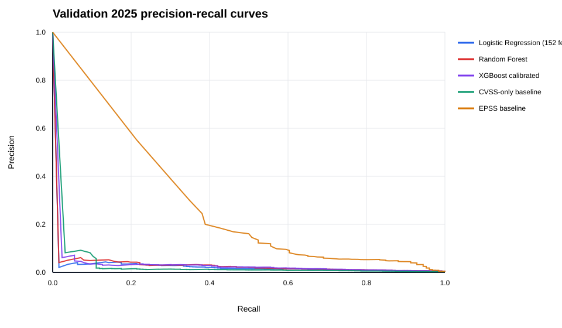
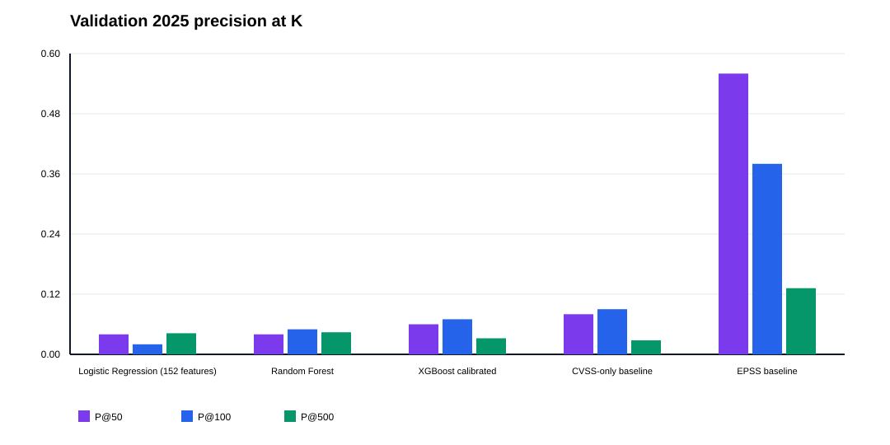

# Validation 2025 model comparison

- Command: `python ml/run_val2025_comparison.py`
- Split: 2022-01-01 through 2024-12-31 training; 2025-01-01 through 2025-12-31 validation.
- Rows: train 93,842 (270 positives); validation 48,152 (126 positives).
- The test partition was not opened. All encoders and TF-IDF vocabulary were fitted on training rows only.
- Model inputs are the frozen 152 features. KEV and EPSS are labels/baselines only, never model inputs.
- Random Forest hyperparameters were selected using four randomized candidates (25/50 trees, depth 4/6/8) and 3-fold stratified CV on training rows only; class weight is balanced and seed is 42. Logistic Regression used fixed `C=1.0` and `class_weight=balanced`; its 3-fold out-of-fold CV selected the decision threshold, not model hyperparameters. The frozen XGBoost model was not tuned in this comparison; its sigmoid calibrator had historically been fitted on Validation 2025.
- LR and RF thresholds use 3-fold out-of-fold training scores. Baseline thresholds use their training scores. The frozen XGBoost threshold uses training-split scores without changing its artifact.
- Top-K ties sort by score descending then CVE identifier ascending. PR-AUC uncertainty is a 200-resample percentile bootstrap 95% interval; one-class samples are skipped.
- EPSS uses the available snapshot and is explicitly a hindsight baseline.

| Model | PR-AUC | Precision | Recall | F1 | ROC-AUC | P@50 | P@100 | P@500 | R@50 | R@100 | R@500 |
|---|---:|---:|---:|---:|---:|---:|---:|---:|---:|---:|---:|
| Logistic Regression (152 features) | 0.020851 | 0.032967 | 0.047619 | 0.038961 | 0.854879 | 0.0400 | 0.0200 | 0.0420 | 0.0159 | 0.0159 | 0.1667 |
| Random Forest | 0.033932 | 0.060606 | 0.031746 | 0.041667 | 0.887909 | 0.0400 | 0.0500 | 0.0440 | 0.0159 | 0.0397 | 0.1746 |
| XGBoost calibrated | 0.035183 | 0.060000 | 0.023810 | 0.034091 | 0.889134 | 0.0600 | 0.0700 | 0.0320 | 0.0238 | 0.0556 | 0.1270 |
| CVSS-only baseline | 0.014753 | 0.062500 | 0.103175 | 0.077844 | 0.790278 | 0.0800 | 0.0900 | 0.0280 | 0.0317 | 0.0714 | 0.1111 |
| EPSS baseline | 0.283077 | 0.593750 | 0.150794 | 0.240506 | 0.967154 | 0.5600 | 0.3800 | 0.1320 | 0.2222 | 0.3016 | 0.5238 |

## Thresholds and confusion matrices

### Logistic Regression (152 features)
- Training-selected threshold: `0.973353287`
- Validation confusion matrix (actual rows, predicted columns): `[[47850, 176], [120, 6]]`
- Parameter tuning: none; fixed `C=1.0`, `class_weight=balanced`, `solver=liblinear`. Three-fold out-of-fold training CV selected the threshold only; validation labels were not used for threshold selection.

### Random Forest
- Training-selected threshold: `0.7600264453`
- Validation confusion matrix (actual rows, predicted columns): `[[47964, 62], [122, 4]]`
- Training CV: `{"best_params": {"max_depth": 6, "max_features": "sqrt", "min_samples_leaf": 2, "n_estimators": 50}, "best_score": 0.06473532093453557, "candidates": [{"mean_test_score": 0.055379898208130274, "params": {"max_depth": 8, "max_features": 0.5, "min_samples_leaf": 8, "n_estimators": 50}, "std_test_score": 0.025975011315812747}, {"mean_test_score": 0.06473532093453557, "params": {"max_depth": 6, "max_features": "sqrt", "min_samples_leaf": 2, "n_estimators": 50}, "std_test_score": 0.010627015806040889}, {"mean_test_score": 0.04885090184732025, "params": {"max_depth": 8, "max_features": "sqrt", "min_samples_leaf": 4, "n_estimators": 25}, "std_test_score": 0.007831102819717922}, {"mean_test_score": 0.049938247335331275, "params": {"max_depth": 8, "max_features": 0.5, "min_samples_leaf": 2, "n_estimators": 25}, "std_test_score": 0.02509857119066221}], "method": "3-fold stratified randomized parameter search on training rows", "n_iter": 4, "random_state": 42, "scoring": "average_precision"}`

### XGBoost calibrated
- Training-selected threshold: `0.05650065467`
- Validation confusion matrix (actual rows, predicted columns): `[[47979, 47], [123, 3]]`

### CVSS-only baseline
- Training-selected threshold: `1`
- Validation confusion matrix (actual rows, predicted columns): `[[47831, 195], [113, 13]]`
- Note: CVSS base score divided by 10; missing values use 6.7.

### EPSS baseline
- Training-selected threshold: `0.97159`
- Validation confusion matrix (actual rows, predicted columns): `[[48013, 13], [107, 19]]`
- Note: Current EPSS snapshot; hindsight baseline, not a prospective feature.

## Reproducibility and artifacts

- Full validation predictions (CVE id, label and one probability per model), metric details, console log, library versions, seeds and SHA-256 hashes are in this JSON file.
- New model files: `ml/models/logreg_val2025_2026-11-14.joblib` and `ml/models/rf_val2025_2026-11-14.joblib`.
- The XGBoost validation probabilities come from the existing frozen calibrated model, used read-only. Its sigmoid calibration was fitted on Validation 2025 historically; this comparison does not refit it.

## Curves and comparative notes

On this split, **XGBoost calibrated** led the three proposal models in PR-AUC (0.0352) and **XGBoost calibrated** led them in ROC-AUC (0.8891); **Random Forest** led the proposal models at the training-selected threshold in F1 (0.0417), while **Random Forest** had the highest proposal-model P@500 (0.0440). The CVSS-only baseline exceeded the proposal models at P@50/P@100 (0.0800/0.0900), but had lower PR-AUC and ROC-AUC than the proposal XGBoost and Random Forest. EPSS had the highest overall ranking metrics (PR-AUC 0.2831, P@100 0.3800); it is a hindsight snapshot and must not be interpreted as a prospective model or input feature.

### Calibration diagnostics

| Model | Brier score | ECE (10 equal-count bins) |
|---|---:|---:|
| Logistic Regression (152 features) | 0.086843 | 0.155706 |
| Random Forest | 0.114311 | 0.291719 |
| XGBoost calibrated | 0.002577 | 0.000523 |
| CVSS-only baseline | 0.466816 | 0.662498 |
| EPSS baseline | 0.003697 | 0.007514 |

Bins are descriptive, computed from the validation predictions without fitting a calibrator. The frozen XGBoost sigmoid calibration was historically fitted on this same validation split, so its calibration diagnostics are not an independent calibration assessment.

Recreate these SVGs from the saved prediction JSON with `python ml/render_val2025_charts.py`.
