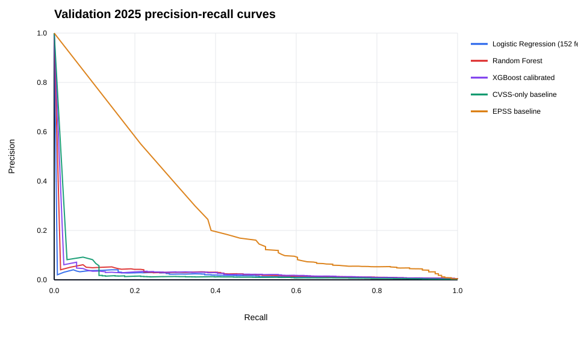
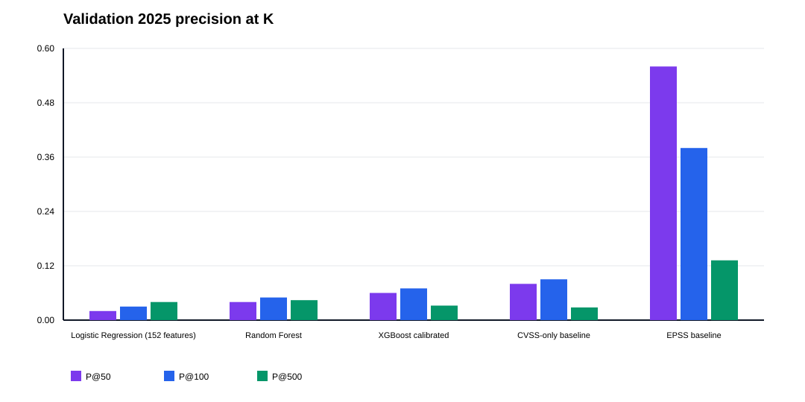

# Validation 2025 model comparison — Logistic Regression tuned

- Command: `python ml/run_val2025_comparison_lr_cv.py`
- Run date: 2026-11-15. This is a new run; the 2026-11-14 report and model are unchanged.
- Split: 2022-01-01 through 2024-12-31 training; 2025-01-01 through 2025-12-31 validation.
- Rows: train 93,842 (270 positives); validation 48,152 (126 positives).
- The 2026 test split was not opened. Validation was loaded only after CV parameter selection and out-of-fold threshold selection on training rows.
- The 152-feature encoder and TF-IDF pipeline was fitted on training rows only. KEV and EPSS are excluded from model features.
- Logistic Regression grid: `C` in `[0.01, 0.1, 1, 10, 100]`; `class_weight` in `[None, "balanced"]`; solver `liblinear`; random seed 42.
- Selected parameters: `{"C": 100, "class_weight": null}`; mean CV average precision `0.06250554`.
- Decision threshold selected by maximum F1 on 3-fold out-of-fold training probabilities; the validation labels do not select the threshold.

## Logistic Regression CV scores

| C | class_weight | Mean CV average precision | CV standard deviation |
|---:|---|---:|---:|
| 0.01 | None | 0.00258634 | 0.00009748 |
| 0.01 | balanced | 0.04219319 | 0.01819710 |
| 0.1 | None | 0.03365132 | 0.00306902 |
| 0.1 | balanced | 0.03383016 | 0.01060803 |
| 1 | None | 0.05633274 | 0.01965528 |
| 1 | balanced | 0.03035873 | 0.01131977 |
| 10 | None | 0.06141204 | 0.02606436 |
| 10 | balanced | 0.03025198 | 0.01313981 |
| 100 | None | 0.06250554 | 0.02821634 |
| 100 | balanced | 0.03034814 | 0.01364954 |

## Fixed vs tuned Logistic Regression on Validation 2025

| Run | PR-AUC | Precision | Recall | F1 | ROC-AUC | P@50 | P@100 | P@500 | R@50 | R@100 | R@500 |
|---|---:|---:|---:|---:|---:|---:|---:|---:|---:|---:|---:|
| Fixed (2026-11-14; C=1, class_weight=balanced) | 0.020851 | 0.032967 | 0.047619 | 0.038961 | 0.854879 | 0.0400 | 0.0200 | 0.0420 | 0.0159 | 0.0159 | 0.1667 |
| Tuned (2026-11-15; C=100, class_weight=None) | 0.021292 | 0.041096 | 0.047619 | 0.044118 | 0.845647 | 0.0200 | 0.0300 | 0.0400 | 0.0079 | 0.0238 | 0.1587 |

## Current Validation 2025 comparison

| Model | PR-AUC | Precision | Recall | F1 | ROC-AUC | P@50 | P@100 | P@500 | R@50 | R@100 | R@500 |
|---|---:|---:|---:|---:|---:|---:|---:|---:|---:|---:|---:|
| Logistic Regression (152 features) | 0.021292 | 0.041096 | 0.047619 | 0.044118 | 0.845647 | 0.0200 | 0.0300 | 0.0400 | 0.0079 | 0.0238 | 0.1587 |
| Random Forest | 0.033932 | 0.060606 | 0.031746 | 0.041667 | 0.887909 | 0.0400 | 0.0500 | 0.0440 | 0.0159 | 0.0397 | 0.1746 |
| XGBoost calibrated | 0.035183 | 0.060000 | 0.023810 | 0.034091 | 0.889134 | 0.0600 | 0.0700 | 0.0320 | 0.0238 | 0.0556 | 0.1270 |
| CVSS-only baseline | 0.014753 | 0.062500 | 0.103175 | 0.077844 | 0.790278 | 0.0800 | 0.0900 | 0.0280 | 0.0317 | 0.0714 | 0.1111 |
| EPSS baseline | 0.283077 | 0.593750 | 0.150794 | 0.240506 | 0.967154 | 0.5600 | 0.3800 | 0.1320 | 0.2222 | 0.3016 | 0.5238 |

## Thresholds and CV details

- Tuned Logistic Regression threshold: `0.09026097032`; validation confusion matrix: `[[47886, 140], [120, 6]]`.
- The Random Forest, XGBoost calibrated, CVSS-only, and EPSS baseline results and predictions are reused unchanged from the 2026-11-14 run; those models were not retrained.
- Frozen XGBoost calibrator exception: its sigmoid calibrator was historically fitted on Validation 2025. The artifact and its validation results were reused read-only.
- EPSS is a hindsight baseline. Top-K ties sort by score descending then CVE identifier ascending.
- PR-AUC uncertainty is a 200-resample percentile bootstrap 95% interval; one-class samples are skipped.

## Reproducibility and artifacts

- Complete validation predictions, scores, metrics, thresholds, CV candidate scores, versions, seeds and SHA-256 hashes are in `val2025_comparison.json`.
- Tuned model: `ml/models/logreg_cv_val2025_2026-11-15.joblib` (8e8914a38cea6be1937e2c7f4f54df42a5fcc96e3e651ad6f02c1377dfa0b6ad).
- Historical fixed-parameter run remains available at `docs/results_offline/2026-11-14/`; neither its result files nor model was overwritten.

On this split, **XGBoost calibrated** led the three proposal models in PR-AUC (0.0352) and **XGBoost calibrated** led them in ROC-AUC (0.8891); **Logistic Regression (152 features)** led the proposal models at the training-selected threshold in F1 (0.0441), while **Random Forest** had the highest proposal-model P@500 (0.0440). The CVSS-only baseline exceeded the proposal models at P@50/P@100 (0.0800/0.0900), but had lower PR-AUC and ROC-AUC than the proposal XGBoost and Random Forest. EPSS had the highest overall ranking metrics (PR-AUC 0.2831, P@100 0.3800); it is a hindsight snapshot and must not be interpreted as a prospective model or input feature.

## Calibration diagnostics

| Model | Brier score | ECE (10 equal-count bins) |
|---|---:|---:|
| Logistic Regression (152 features) | 0.002638 | 0.001400 |
| Random Forest | 0.114311 | 0.291719 |
| XGBoost calibrated | 0.002577 | 0.000523 |
| CVSS-only baseline | 0.466816 | 0.662498 |
| EPSS baseline | 0.003697 | 0.007514 |

Calibration diagnostics are descriptive. No new calibrator was fitted on Validation 2025 for this run; the frozen XGBoost calibrator remains a disclosed historical exception.
